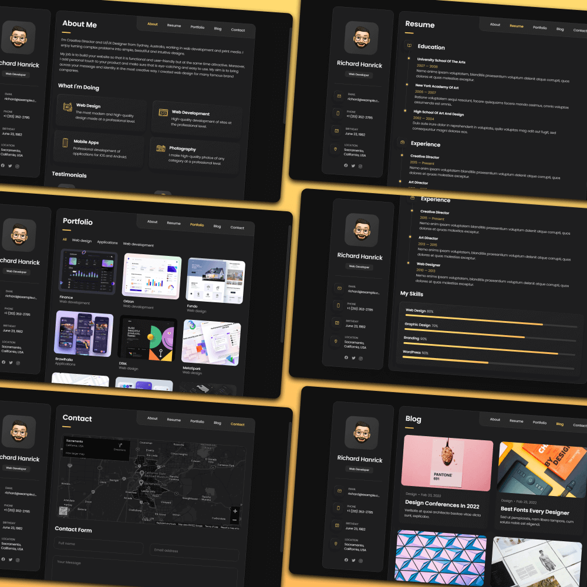
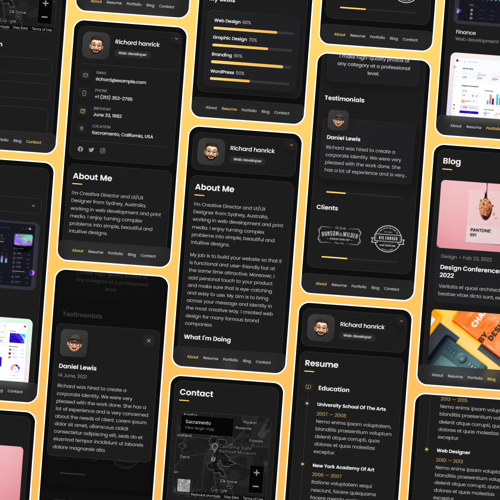

<div align="center">

# 🌐 Rohit Rai · Portfolio

### My personal website: experience, projects and contact in one place

**[rohit-rai.com](https://rohit-rai.com)**


</div>

---

## 🖥️ Preview

<div align="center">





</div>

## 📄 What's inside

| | Section | What it shows |
|---|---|---|
| 👤 | **About** | Who I am, what I work on, and the areas I focus on: cloud, APIs, mobile and GenAI |
| 📚 | **Resume** | Education (University of Stuttgart, DJ Sanghvi), work experience and skills |
| 🚀 | **Projects** | Selected projects with tech stack, description, GitHub and demo links in a pop-up |
| ✉️ | **Contact** | Contact form and location |

## ✨ Highlights

- **No framework**: plain HTML, CSS and JavaScript, so it loads fast and is easy to maintain
- **Single-page navigation**: tabs switch between sections without reloading
- **Project pop-ups**: each project opens a modal with details, tech stack and links
- **Responsive**: sidebar collapses into a contact card on mobile
- **Deployed on Netlify**: every push to `main` goes live automatically

## 📁 Project structure

```
portfolio-website/
├── index.html              # All sections and content
├── assets/
│   ├── css/style.css       # Styles and responsive layout
│   ├── js/script.js        # Navigation, sidebar and project modal
│   └── images/             # Avatar, icons and project images
└── website-demo-image/     # Screenshots for this README
```

## 🏃 Run locally

No build step needed. Clone the repo and open `index.html` in a browser:

```bash
git clone https://github.com/rohit0407rai/portfolio-website.git
cd portfolio-website
open index.html
```

## ✏️ Updating content

All content lives in `index.html`:

- **Experience and education**: the `timeline-list` sections under Resume
- **Projects**: each `project-item` holds its title, tech stack, description and links in `data-` attributes

## 🙏 Credits

Layout based on the open-source [vCard personal portfolio](https://github.com/codewithsadee/vcard-personal-portfolio) template, customised with my own content, sections and project modal.

---

<div align="center">

Made with 💙 by [Rohit Rai](https://github.com/rohit0407rai) · [LinkedIn](https://linkedin.com/in/rohit-0407-rai/)

</div>
